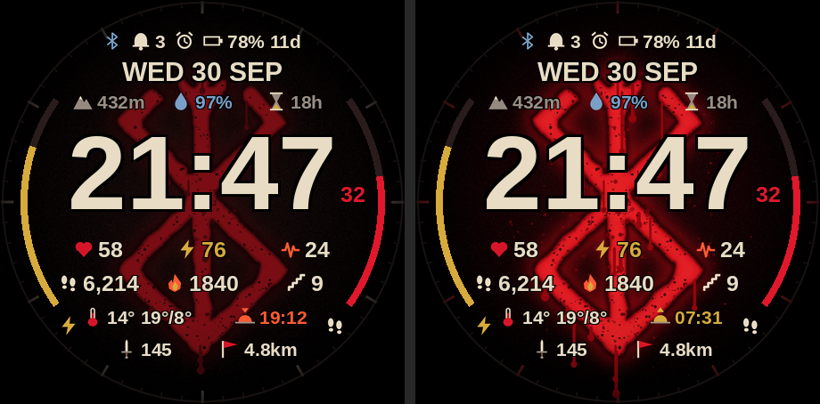

# Berserk Brand — Garmin watch face

A data-dense Connect IQ watch face on top of the **Brand of Sacrifice**. By
day the brand is a dormant, worn scar. After sunset it **bleeds**, just like in
the manga.



*(left: day / dormant, right: night / bleeding. Mock-up with system fonts, so
the real Garmin fonts look slightly different.)*

## What's on the face

| Where | Data |
|---|---|
| Top status row | Phone connection, notification count, alarm, Do Not Disturb, battery % + estimated days left |
| Date | `WED 30 SEP` |
| Under the date | Altitude · Pulse Ox (SpO2) · Recovery time |
| Centre | Time (12/24 h from watch settings) + red seconds while awake |
| Row 1 | Heart rate · Body Battery · Stress (orange above 75) |
| Row 2 | Steps · Calories · Floors climbed |
| Row 3 | Temperature with high/low · next sunrise or sunset |
| Row 4 | Weekly intensity minutes · Distance (km/mi from watch settings) |
| Left gauge | Body Battery |
| Right gauge | Step goal (turns gold when reached) |

**Always-on (AMOLED):** a dim outline of the brand, the time and the date. It
lights fewer than 10% of pixels and shifts position every minute to prevent
burn-in.

**Settings** (Connect IQ app → watch face settings):
- *Brand of Sacrifice*: bleeds at night (default) / always dormant / always bleeding
- *Show seconds*

## Build & install

1. Install the [Connect IQ SDK](https://developer.garmin.com/connect-iq/sdk/)
   and the *Monkey C* VS Code extension. In the SDK Manager, download the
   device files for your watch.
2. **Device id:** `manifest.xml` targets the fenix 8 / fenix 8 Pro ids. For a
   **fenix 9 Pro**, open *SDK Manager → Devices*, find its id, and add a
   `<iq:product id="..."/>` line. If the compiler reports an unknown id,
   delete that line. The layout scales to any round screen. There are
   pre-rendered backgrounds for 454×454 and 416×416, and other sizes use the
   454 art, centred.
3. VS Code: `Monkey C: Build for Device` (or `Run` to open the simulator).
   Command line:
   ```sh
   monkeyc -f monkey.jungle -d <device-id> -o bin/BerserkBrand.prg -y /path/to/developer_key.der
   ```
4. Copy `bin/BerserkBrand.prg` into `GARMIN/Apps/` on the watch over USB, then
   choose it under *Watch Face*.

## Artwork

All bitmaps are generated by a script:

```sh
pip install pillow numpy
python3 tools/gen_assets.py            # traces art/brand.png
python3 tools/gen_assets.py --brand other.png
python3 tools/preview.py art/preview.png
```

`art/brand.png` is the reference silhouette. The script traces it (black
strokes on white, or opaque on transparent) and fits it to the dial. It then
adds the glow, scar rim, worn specks, drips and splatter.
